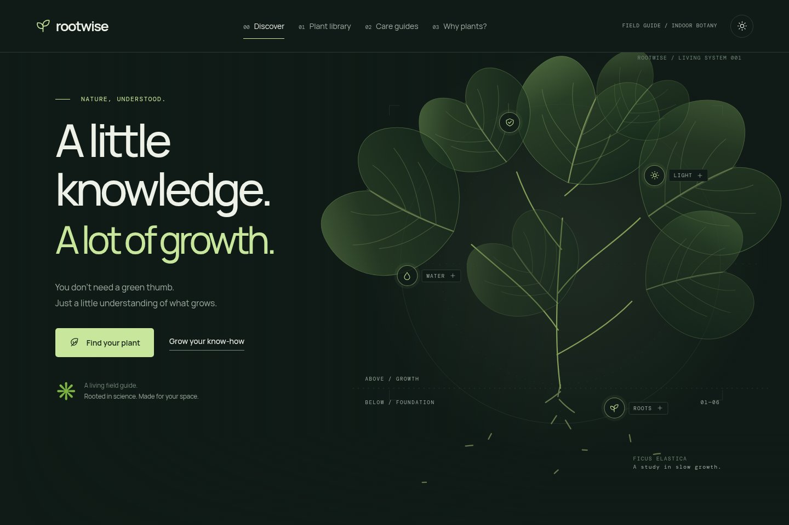
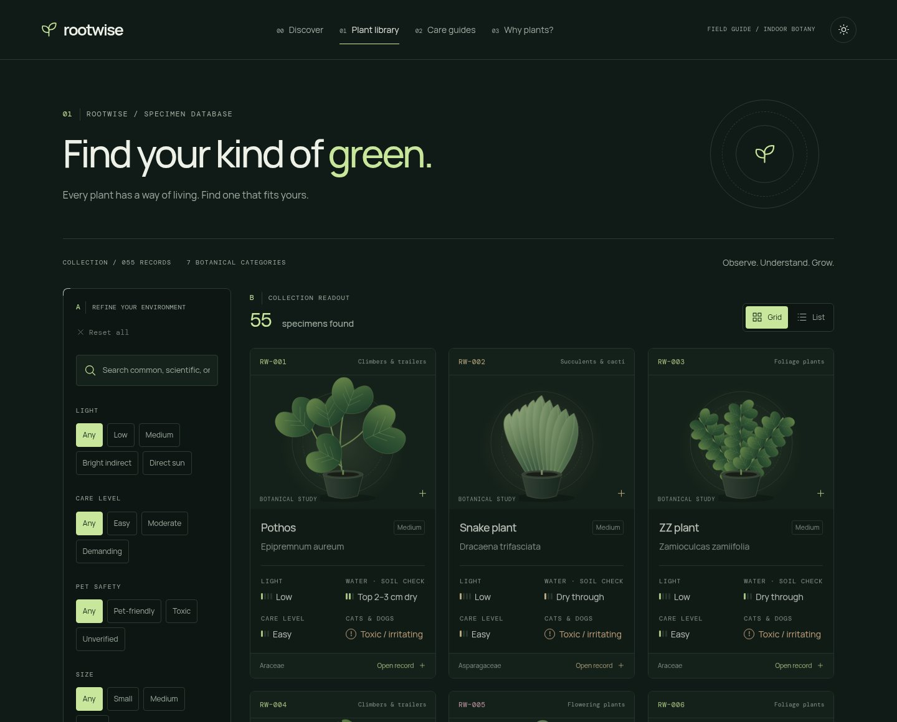
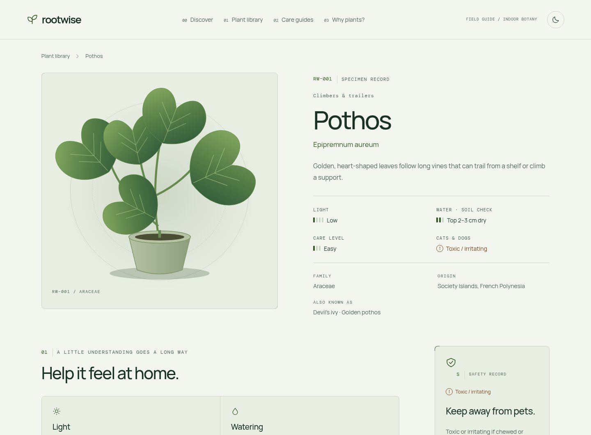

# Rootwise

Rootwise is a static indoor-plant field guide built with **React, TypeScript, Vite, and build-time prerendering**. It combines an interactive SVG plant with a searchable collection of 55 plant records, six practical care guides, and an evidence-aware look at plant benefits. It has no backend, accounts, analytics, visitor editing, or runtime CDN requests.

**[Visit Rootwise](https://naumansaeed0.github.io/Rootwise/)** · [Documentation](docs/README.md) · [Design system](docs/design-system.md)

## Screenshots



| Plant Library · dark                                                                                                              | Plant record · light                                                                                                                               |
| --------------------------------------------------------------------------------------------------------------------------------- | -------------------------------------------------------------------------------------------------------------------------------------------------- |
| [](docs/screenshots/library-dark.jpg) | [](docs/screenshots/plant-light.jpg) |

These screenshots come from the final production build. See [capture instructions](docs/screenshots/README.md).

## Features

- **Living Plant:** scroll-driven SVG stems and roots grow thicker, with keyboard-accessible care panels, optional auto exploration, Escape/focus handling, and a static reduced-motion version.
- **55-plant library:** common/scientific/alternate-name search; combined light, difficulty, pet safety, size, and category filters; shareable query parameters; reset and clear result counts.
- **Grid and list views:** specimen cards and a semantic table; the preferred view is remembered locally, with a fallback when storage is unavailable.
- **Plant records:** botanical identity, origin, care, propagation, safety, common problems, related names, sources, and explicit verification notes.
- **Six care guides:** watering, light, humidity, repotting, pests, and low-light spaces.
- **Evidence-aware benefits:** distinguishes possible wellbeing benefits from overstated indoor-air-cleaning claims.
- **Light/dark mode and plant palettes:** system-aware mode, remembered choice, and canopy/forest/desert/bloom accents.
- **Accessibility and performance work:** semantic controls, visible focus, text-equivalent meters/safety states, responsive layouts, reduced motion, automated audits, and mobile lab measurements.

## Stack

| Layer                 | Used in this project                                                     |
| --------------------- | ------------------------------------------------------------------------ |
| UI                    | React + TypeScript                                                       |
| Build                 | Vite + build-time React prerendering                                     |
| Hosting               | Static HTML/CSS/JavaScript on GitHub Pages                               |
| Artwork and motion    | Original SVG, CSS, requestAnimationFrame, IntersectionObserver; no WebGL |
| Fonts                 | Self-hosted Manrope and DM Mono                                          |
| Verification          | Node test runner via tsx, Playwright, axe, Lighthouse                    |
| Backend / runtime CDN | None                                                                     |

The build generates **62 HTML documents**, including 55 plant records. URLs such as `plant-pothos.html` load and refresh without server routing. Compatibility URLs such as `plant.html?slug=pothos` still work with JavaScript. Library conditions use query parameters; guides use fragments such as `guides.html#watering`.

## Run, build, and test

Use **Node.js 24+** and npm.

```sh
npm ci
npm run dev
```

Vite prints the development URL. For the complete production check:

```sh
npm run verify       # 7 unit tests, TypeScript, build/prerender, local-link checks
npm run test:browser # 11 browser/audit tests; starts a production preview if needed
npm run preview     # preview the built site
```

Browser tests use system Chromium at `/usr/bin/chromium`; set `CHROME_PATH` to another installed Chromium/Chrome executable when needed. The managed Linux test configuration uses container-compatible launch flags. Run browser checks after building so they exercise current output.

The generated files can also be served without Node:

```sh
python3 -m http.server 8080 --directory dist
```

For repeatable measurements or README screenshots, keep a preview running:

```sh
npm run preview -- --port 4174 --strictPort
# In another terminal:
npm run audit:mobile
npm run audit:contrast
npm run screenshots
```

## Project structure

| Path                          | What lives there                                                            |
| ----------------------------- | --------------------------------------------------------------------------- |
| `src/App.tsx`                 | Navigation, page templates, static route selection                          |
| `src/pages/Library.tsx`       | Library controls and grid/table presentation                                |
| `src/data/plants.json`        | All structured plant records                                                |
| `src/data/plants.ts`          | Plant type, categories, source links, filtering                             |
| `src/data/guides.ts`          | The six guide articles                                                      |
| `src/living-plant/`           | Isolated SVG plant controller and editable configuration                    |
| `src/components/ui/`          | Panels, indexed headings, controls, meters, safety/readout components       |
| `src/components/PlantArt.tsx` | Original reusable botanical SVG artwork                                     |
| `src/styles/system.css`       | Shared design-system tokens/primitives                                      |
| `src/styles/instruments.css`  | Instrument-style page layouts                                               |
| `src/styles/main.css`         | Base styles, palettes, and established hero styles                          |
| `src/library/preferences.ts`  | Guarded grid/list storage                                                   |
| `src/entry-server.tsx`        | Build-time React renderer                                                   |
| `scripts/prerender.mjs`       | Static pages, SEO files, and published license notices                      |
| `scripts/verify-build.mjs`    | Generated-page, asset, link, and notice checks                              |
| `scripts/check-live.mjs`      | TLS-verified live page/asset/notice comparisons                             |
| `scripts/deploy.mjs`          | Verified publication with append-only gh-pages history                      |
| `tests/`                      | Unit, behavior, responsive, and accessibility checks                        |
| `docs/`                       | Maintenance guides, source/data reviews, reports, screenshots, measurements |

## Add a plant

1. Copy a record in `src/data/plants.json` and append it with a unique lowercase, hyphenated `slug`. Appending preserves existing catalogue indices; reordering records changes their `RW–NNN` codes.
2. Fill every field below using species-specific references. Keep wording original, retain source links, and avoid unsupported medical/air-cleaning claims.
3. Set safety and verification fields deliberately. If cat/dog safety is not confirmed, use **`Unverified`**, set **`needsVerification: true`**, and explain the uncertainty in **`verificationNotes`**. Never infer safety from the absence of a warning. A taxonomy/care uncertainty may require notes while a known toxicity label remains unchanged.
4. Choose an existing illustration shape and palette. If water guidance introduces a new text pattern, update the explicit summary mapping in `src/components/ui/PlantReadouts.tsx`; its fallback is “See care record.” Never invent a watering frequency.
5. Update the deliberately fixed collection counts/expectations in `tests/plants.test.ts`, `tests/readouts.test.ts`, `tests/e2e/`, and `scripts/verify-build.mjs`. Update public “55 plants” copy and documentation if the collection grows.
6. Run `npm run verify` and `npm run test:browser`. The build automatically emits `plant-<slug>.html` and adds it to the sitemap; do not hand-write a new plant page.

### Record schema

| Field                                  | Type / accepted values                                                                                                    |
| -------------------------------------- | ------------------------------------------------------------------------------------------------------------------------- |
| `slug`, `commonName`, `scientificName` | Strings; slug is unique and URL-safe                                                                                      |
| `alternateNames`                       | String array; may be empty; included in search                                                                            |
| `family`, `origin`, `description`      | Strings                                                                                                                   |
| `category`                             | String; use an existing sensible category unless intentionally extending the collection                                   |
| `theme`                                | `canopy`, `forest`, `desert`, `bloom`                                                                                     |
| `shape`                                | `heart`, `split`, `oval`, `round`, `sword`, `grass`, `palm`, `fern`, `zz`, `rosette`, `bloom`                             |
| `light`                                | `Low`, `Medium`, `Bright indirect`, `Direct sun`                                                                          |
| `difficulty`                           | `Easy`, `Moderate`, `Demanding`                                                                                           |
| `size`                                 | `Small`, `Medium`, `Large` — editorial indoor-scale groups                                                                |
| `toxicity`                             | Object: `pets` is `Non-toxic`, `Toxic`, or `Unverified`; `humans` is a written child/handling safety note                 |
| `care`                                 | Object with eight strings: `light`, `water`, `humidity`, `temperature`, `soil`, `fertilizing`, `repotting`, `propagation` |
| `benefits`, `related`                  | String arrays; related names do not create separate records                                                               |
| `commonProblems`                       | Array of `{ "symptom": "…", "fix": "…" }`                                                                                 |
| `sources`                              | Array of `{ "label": "…", "url": "https://…" }`                                                                           |
| `needsVerification`                    | Boolean; true when verification notes exist                                                                               |
| `verificationNotes`                    | String array explaining each unresolved item; empty for reviewed records without open notes                               |

The pet-friendly filter includes only `Non-toxic`; `Unverified` is visibly distinct and excluded. These labels concern cats and dogs, not every animal. The illustrations are decorative, not identification tools.

## Tweak the Living Plant

Edit [src/living-plant/config.ts](src/living-plant/config.ts): `stems`/`roots` define paths in a 900 × 900 viewBox; `leaves` defines attachment/rotation/scale; `plantNodes` defines positions, tags, accessible labels, text, and guide links. `growthConfig` controls initial drawing, stroke thickness, and auto-scroll speed.

The renderer is `LivingPlant.tsx`. CSS `.living-section` height controls manual growth distance; `--hero-leaf-*`, `--hero-stem`, and `--root` control appearance. Keep node tags in their accessible names. Preserve passive frame scheduling, reduced motion, keyboard/focus handling, and manual-input pause behavior when editing.

## Design system

The shared language uses bracketed panels, indexed headings, technical readouts, orbital study frames, and restrained state changes. `system.css` defines reusable tokens; `src/components/ui/` supplies components; `instruments.css` applies them to pages. Safety uses symbols and text as well as color. All data remains visible without hovering.

See [component examples and extension guidance](docs/design-system.md). Theme and view choices are stored locally; no personal plant collection or remote user data is stored.

## Plant data, sources, and safety

Species/care references include NC State Extension, UF/IFAS, UMN Extension, Clemson Extension, ASPCA, Smithsonian Gardens, and Kew. The benefits page cites RHS research and published reviews. References are linked in each record; no third-party photographs or source article text is redistributed.

**Nine records still carry verification notes:** peace lily, velvet-leaf philodendron, Chinese evergreen, elephant ear, prayer plant, Chinese money plant, Christmas cactus, maidenhair fern, and moth orchid. The exact issues are listed in the [data review](docs/data-review.md). Prayer plant, Chinese money plant, and maidenhair fern retain **Unverified** pet-safety labels. Other flags concern species-level evidence or identity/nursery names.

Pet-friendly/non-toxic does **not** mean edible. Any plant material may cause stomach upset. Do not use this guide to diagnose ingestion, identify an unknown plant, or choose medicinal treatment. Contact a veterinarian or local poison service for suspected exposure. Care ranges, difficulty, and size are starting points that depend on conditions.

The [wording review](docs/content-review.md) found no copied passages in the reviewed descriptions/guides against the cited material; it is not an exhaustive originality or legal guarantee.

## Quality and limitations

| Mobile Lighthouse | Performance | Accessibility | Best practices | SEO |
| ----------------- | ----------: | ------------: | -------------: | --: |
| Home              |         100 |           100 |            100 | 100 |
| Library           |          99 |           100 |            100 | 100 |
| Plant record      |          99 |           100 |            100 | 100 |

These are **local production-build lab measurements**, using simulated mobile network/CPU throttling, not field data or physical-phone results. Full results, including Lighthouse's separate experimental category and manual-review entries, are in [docs/lighthouse/](docs/lighthouse/README.md).

The final suite has **7 passing unit tests and 11 passing browser/audit tests**. The browser checks include 32 axe scans across light/dark modes, four plant palettes, desktop/mobile layouts, and library states. The inherited ROOTS accessible-name mismatch is fixed, and its former audit exception is removed. Incomplete/manual-review entries remain in the reports; **full WCAG AA conformance is not claimed**.

The live headless browser still lacks trust for this managed environment's HTTPS proxy certificate. The configured system client and Playwright's HTTPS request client with the environment proxy validate HTTPS successfully, without disabling certificate verification. See the [final report](docs/final-polish-report.md) for the distinction between local browser tests and live network verification.

## Publish a new build

**`main` contains source; `gh-pages` contains only the published files and notices.** Do not merge the branches together.

```sh
npm run verify
npm run test:browser
# Commit and push source changes using a conventional commit message.
git push origin main
npm run deploy
npm run check:live  # certificate-validated comparison with the built files
```

`npm run deploy` requires a clean checkout, re-runs verification, checks out the existing `gh-pages` history in a temporary worktree, replaces only published file contents, and appends a normal deployment commit. It never force-pushes or rewrites branch history. Concurrent remote updates cause a normal push rejection rather than being overwritten.

The custom Actions workflow is **manual-trigger only** because GitHub currently refuses jobs due to an **account billing lock**. Source pushes no longer create noisy failed runs. Do not dispatch that workflow until billing is resolved; use the local publication command meanwhile. GitHub's separate Pages hosting job serves the published branch.

Pages configuration: **Settings → Pages → Source: Deploy from a branch → `gh-pages` → `/ (root)`**. The site already uses this deployment path. Relative assets/links support the repository subpath; changing the repository URL also requires updating canonical/SEO and 404 base settings in the prerender script.

## License and credits

**Code is MIT licensed**, copyright **2026 naumansaeed0**. The GitHub profile has no display name, so its account handle is used; see [LICENSE](LICENSE).

The written plant content and original SVG illustrations are part of this project and covered by the **same MIT license unless the owner decides otherwise in a future change**. This does not relicense third-party material. Bundled fonts remain under SIL OFL 1.1; runtime libraries retain their MIT notices.

Manrope is credited to The Manrope Project Authors/Mikhail Sharanda; DM Mono to The DM Mono Project Authors/Colophon Foundry. React, React DOM, Scheduler, and the Vite-generated helper are also attributed. Complete notices are in [THIRD_PARTY_NOTICES.md](THIRD_PARTY_NOTICES.md) and [docs/licenses/](docs/licenses/README.md), and are included in the published build.

## Reports

[Documentation index](docs/README.md) · [Round 1](docs/report.md) · [Round 2](docs/round-2-report.md) · [Final polish](docs/final-polish-report.md) · [Current audit evidence](docs/audits/README.md)
